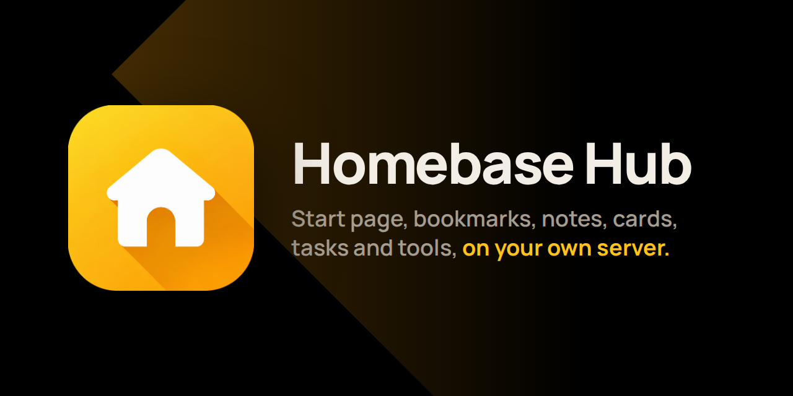

<h1 align="center">Homebase Hub</h1>

<p align="center"></p>

<p align="center"><b>Everything you open every day, in one private place on your own hosting.</b><br>
Start page, bookmarks, notes, cards, tasks and browser tools. One login, one look, no database.</p>

<p align="center">
<a href="https://github.com/Jackpison/Homebase-Hub/releases/latest"><b>Download</b></a> ·
<a href="https://jackpison.github.io/Homebase-Hub/">Website</a> ·
<a href="https://jackpison.github.io/Homebase-Hub/Homebase-Hub-Guide.pdf">User Guide (PDF)</a> ·
<a href="https://jackpison.github.io/Homebase-Hub/changelog/">Changelog</a>
</p>

<p align="center"></p>

## Why Homebase Hub

- **Yours alone.** It runs on your own PHP hosting. Nothing is sent to anyone else unless you turn a feature on.
- **Private by design.** One password, optional two-step login, and tabs and backups you can encrypt with your own passphrase.
- **Simple to run.** Upload one zip and open your domain. There is no database to set up, and updates are one click with a safety copy first.
- **One home for small things.** The pages share a single bar, login, look and Settings page, so everything feels like one app.

It needs PHP 8.3 or newer. Dark is the default, and light mode is one click away.

## What is inside

| Page | What it does |
|---|---|
| **Home** | Your start page. Background photos change on their own, with the credit in the corner. Show it with or without the bar. |
| **Links** | Bookmarks in tabs and categories. Icons are saved on your server, each tab has its own colours and text size, and tabs can be encrypted. |
| **Info** | Notes in tabs. Each tab holds 1 to 12 boxes, arranged as cards or written as one document with an outline. Encrypted tabs for private notes. Export as PDF or text. |
| **Cards** | Your cards in one searchable table, filtered by bank, network, type and holder. Yearly charges are added up, and you can export to Excel. |
| **Tasks** | Bills, renewals and chores with due dates, repeats and prices. Smart lists, a calendar, analytics, a Year in Review PDF and reminders in Telegram. |
| **Tools** | Image, PDF and text tools that run in your browser: crop, resize and convert images, merge and sign PDFs, read text from images, remove backgrounds, make QR codes and more. |
| **Settings** | Guided Setup, appearance (166 presets and your own colours), security, Telegram, backup and restore, updates, a health check and a changelog. |

<p align="center"></p>

<p align="center"></p>

<p align="center"></p>

<p align="center"></p>

## Install

1. Download `site-update-X.Y.Z.zip` from the [latest release](https://github.com/Jackpison/Homebase-Hub/releases/latest).
2. In your hosting file manager, upload it to your domain's folder (for example `public_html`) and extract it there.
3. Open your domain and click the key icon. Enter the setup code from `site-data/core/SETUP-CODE.php` and choose a password.

> **Never delete `site-data`.** It holds all your data, and updates never touch it.

### Updating

Open **Settings > Updates**.

1. Press **Check Now** to look for a new version on GitHub. The daily check is off unless you turn it on.
2. Press **Download and Check**. The download is verified against its SHA-256, and you see what will change.
3. Apply it with your password. A copy of the current version is kept first, and **Go Back** restores it.

You can also upload a zip in the same place.

## Security in short

- **Login:** one bcrypt password, optional two-step login with recovery codes, trusted browsers and a device list. Logins pause after five wrong tries.
- **Encryption:** tabs in Links and Info and your backups can be encrypted. The keys are made in your browser from your passphrase, so a lost passphrase and recovery key means lost data.
- **Closed data:** data files answer 404 to a browser, even on hosts where `.htaccess` is ignored.
- **Safe updates:** they come only from this project's GitHub releases, are checked before anything changes, and need your password. Releases are not signed: the checksum catches damaged downloads, not a compromised account.
- **PHP support:** Settings tells you when your PHP stops getting security fixes. An update that needs a newer PHP than your server has is refused.

More on the [Security page](https://jackpison.github.io/Homebase-Hub/security/).

## Where things are stored

| What | Where |
|---|---|
| Your data: pages, settings, login, backups | `site-data/` in your site folder, closed to browsers |
| Your logo, start page photos and saved link icons | `web/core-data/media/`, never replaced by an update |
| The README, changelog and readable source | `web/docs/`, closed to browsers |

## Building and testing

The readable source is in `src/`. To build the update zip you need Python 3 and Node:

```
npm ci
python3 tools/build.py
```

This writes `build/site-update-X.Y.Z.zip` and its `.sha256`. `python3 tools/make-site.py` builds the website and the PDF guide into `build/site`. [AGENTS.md](AGENTS.md) lists every check to run before a change.

Releases are made by pushing a tag `vX.Y.Z` that matches the version in `src/web/core-data/lib/boot.php`. The release workflow builds the zip, publishes the release and updates the website.

## Changelog

Every version is in [CHANGELOG.md](CHANGELOG.md) and on the [website](https://jackpison.github.io/Homebase-Hub/changelog/). Each release page lists only what changed in that version.

## Contact

Questions and feature requests: Telegram [@Jackpison](https://t.me/Jackpison). Bugs: [GitHub Issues](https://github.com/Jackpison/Homebase-Hub/issues). Security problems: please message on Telegram rather than opening a public issue.

## Licence and credits

Homebase Hub is free software under the [GPL-3.0](LICENSE). Bundled libraries keep their own licences, listed in [THIRD-PARTY.md](THIRD-PARTY.md). The website uses the Manrope font (SIL Open Font License). Start page photos in the screenshots carry their own credits.
