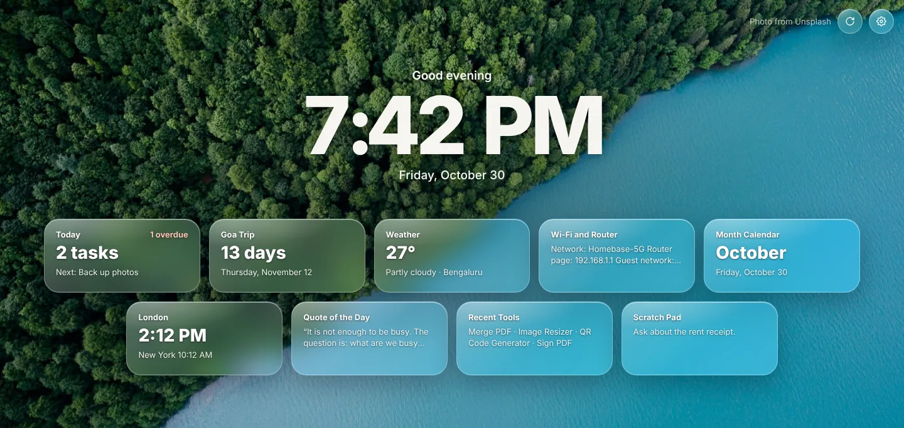
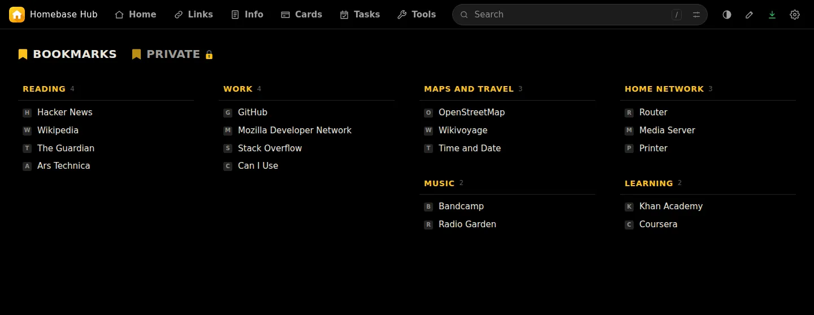
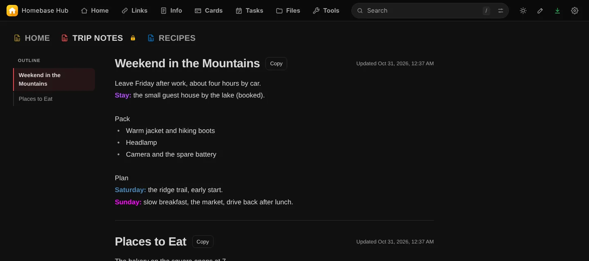
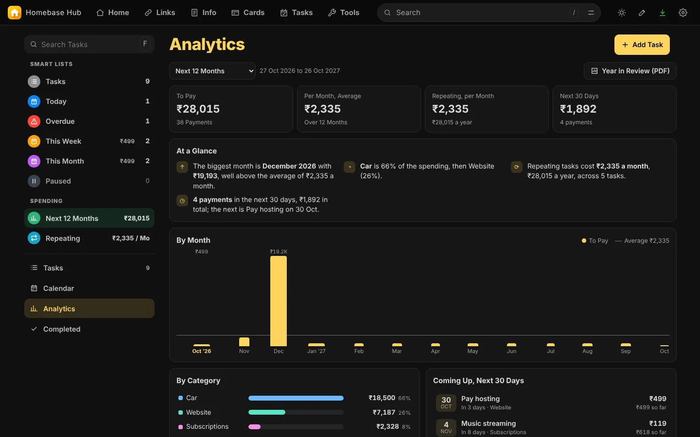
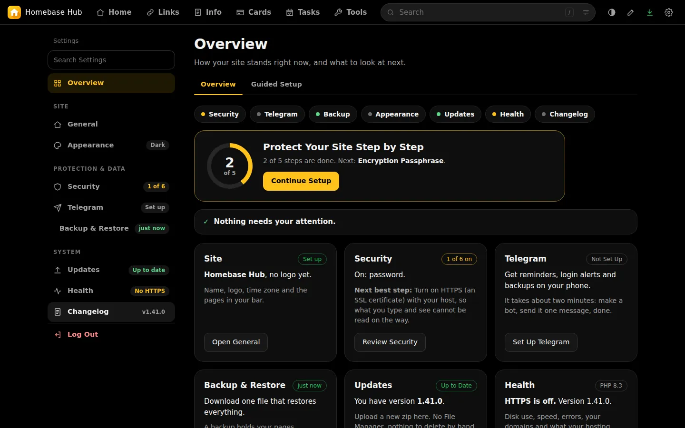

<p align="center"></p>

<h1 align="center">Homebase Hub</h1>

<p align="center">A self-hosted start page with bookmarks, notes, cards, tasks and browser tools.<br>One login, private, on your own server.</p>

<p align="center">
<a href="https://github.com/Jackpison/Homebase-Hub/releases/latest"><b>Download</b></a> ·
<a href="https://jackpison.github.io/Homebase-Hub/">Website</a> ·
<a href="https://jackpison.github.io/Homebase-Hub/Homebase-Hub-Guide.pdf">User guide (PDF)</a> ·
<a href="https://jackpison.github.io/Homebase-Hub/changelog.html">Changelog</a>
</p>

<p align="center"></p>

## What it is

Homebase Hub puts the small things you open every day in one place on your own hosting: a start page, your bookmarks, notes, cards, tasks with due dates, and a set of browser tools. The pages share one login, one bar, one look and one Settings page. There is no database; your data lives in one folder that browsers cannot open.

It runs on ordinary PHP hosting (PHP 8.3 or newer). Dark is the default, and light mode is one click away.

## Pages

**Home.** Your start page, with background photos that change and their credit in the corner.

**Links.** Bookmarks in tabs and categories. Link icons are saved on your server, and tabs can be encrypted.



**Info.** Notes in tabs, 1 to 12 boxes each, arranged as cards or written as one document with an outline. Export as PDF or text.



**Cards.** Your cards in a table you can search and filter, with yearly charges added up.

**Tasks.** Bills, renewals and chores with due dates, repeats and prices. Smart lists, a calendar, analytics, a Year in Review PDF, and reminders in Telegram.



**Tools.** Image, PDF and text tools that run in your browser: crop, resize and convert images, merge and sign PDFs, read text from images, remove backgrounds, make QR codes, and more.

**Settings.** Guided setup, appearance (166 presets and your own colours), security, Telegram, backup and restore, updates and health checks.



## Install

1. Download `site-update-X.Y.Z.zip` from the [latest release](https://github.com/Jackpison/Homebase-Hub/releases/latest).
2. In your hosting file manager, upload it to your domain's folder (for example `public_html`) and extract it there.
3. Open your domain, click the key icon, and enter the setup code from `site-data/core/SETUP-CODE.php` with a new password.

Never delete `site-data`: it holds all your data, and updates never touch it.

### Updating

Open **Settings > Updates**. Press **Check Now** to look for a new version on GitHub, then **Download and Check**: the download is checked against its SHA-256, you see what will change, and you apply it with your password. You can also upload a zip in the same place. A copy of the current version is kept first, and **Go Back** restores it. The daily check is off unless you turn it on.

## Where things are stored

| What | Where |
|---|---|
| Your data (pages, settings, login, backups) | `site-data/` in your site folder, closed to browsers |
| Your logo, start page photos, saved link icons | `web/core-data/media/`, never replaced by an update |
| The README, changelog and readable source | `web/docs/`, closed to browsers |

## Security in short

- One password (bcrypt), optional two-step login with recovery codes, trusted browsers and a device list. Logins pause after five wrong tries.
- Encrypted tabs in Links and Info, and encrypted backups. Keys are made in your browser from your passphrase.
- Data files answer 404 to a browser even where `.htaccess` is ignored.
- Needs PHP 8.3 or newer. Settings tells you when your PHP stops getting security fixes, and an update that needs a newer PHP than your server has is refused.
- Updates come only from this project's GitHub releases, are checked before anything changes, and need your password. Releases are not signed: the checksum catches damaged downloads, not a compromised account.

More: [Security](https://jackpison.github.io/Homebase-Hub/security.html).

## Building and testing

The readable source is in `src/`. To build the update zip (needs Python 3 and Node):

```
npm i --no-save esbuild
python3 tools/build.py
```

This writes `build/site-update-X.Y.Z.zip` and its `.sha256`. The zip always contains the full `CHANGELOG.md`. `python3 tools/make-site.py` builds the website and the PDF guide into `build/site`.

Releases are made by pushing a tag `vX.Y.Z` that matches the version in `src/web/core-data/lib/boot.php`. The release workflow builds the zip, publishes the release and updates the website.

## Changelog

The full history of every version is in [CHANGELOG.md](CHANGELOG.md) and on the [website](https://jackpison.github.io/Homebase-Hub/changelog.html). Each release page lists only what changed in that version.

## Contact

Questions and feature requests: Telegram [@Jackpison](https://t.me/Jackpison). Bugs: [GitHub Issues](https://github.com/Jackpison/Homebase-Hub/issues). Security problems: please message on Telegram rather than opening a public issue.

## Licence and credits

Homebase Hub is free software under the [GPL-3.0](LICENSE). Bundled libraries keep their own licences; see [THIRD-PARTY.md](THIRD-PARTY.md). The website uses the Manrope font (SIL Open Font License). Start page photos in the screenshots carry their own credits.
