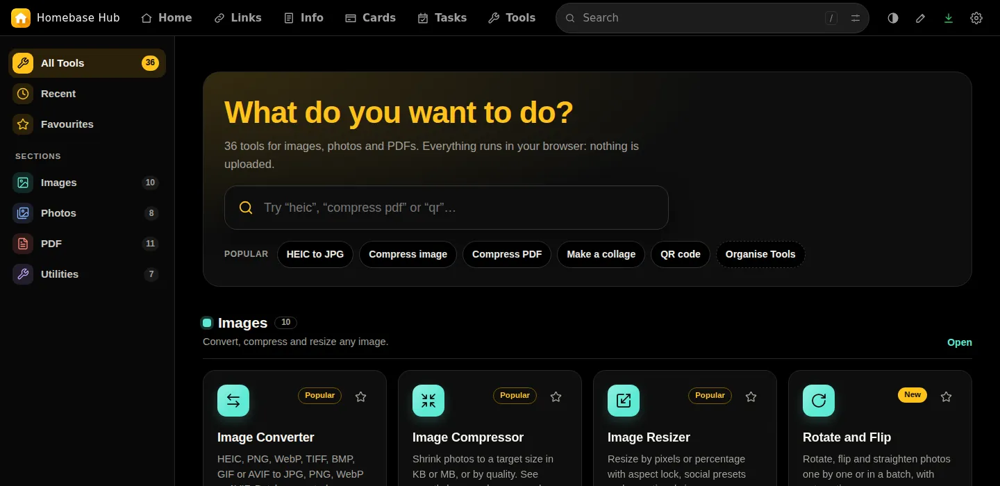
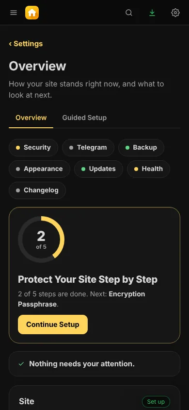

<p align="center"></p>

<h1 align="center">Homebase Hub</h1>

<p align="center"></p>

<p align="center"><b>Everything you open every day, in one private place on your own hosting.</b><br>
Start page, bookmarks, notes, cards, tasks and browser tools. One login, one look, no database.</p>

<p align="center">
<a href="https://github.com/Jackpison/Homebase-Hub/releases/latest"><b>⬇️ Download</b></a> &nbsp;·&nbsp;
<a href="https://jackpison.github.io/Homebase-Hub/">🌐 Website</a> &nbsp;·&nbsp;
<a href="https://jackpison.github.io/Homebase-Hub/Homebase-Hub-Guide.pdf">📘 User Guide (PDF)</a> &nbsp;·&nbsp;
<a href="https://jackpison.github.io/Homebase-Hub/changelog/">📝 Changelog</a> &nbsp;·&nbsp;
<a href="https://jackpison.github.io/Homebase-Hub/security/">🛡️ Security</a> &nbsp;·&nbsp;
<a href="https://t.me/Jackpison">💬 Telegram</a>
</p>

<p align="center">🆓 Free and open source (GPL-3.0) &nbsp;·&nbsp; 🐘 PHP 8.3 or newer &nbsp;·&nbsp; 🗄️ No database &nbsp;·&nbsp; 🌗 Dark and light</p>

---

## ✨ What is inside

<table>
<tr>
<td width="25%" valign="top"><b>🏠 Home</b><br>A start page that feels like yours.<br><br>• Background photos that change<br>• Phone-sized copies load fast<br>• With or without the bar</td>
<td width="25%" valign="top"><b>🔗 Links</b><br>Bookmarks in tabs and categories.<br><br>• Icons saved on your server<br>• Colours and sizes for each tab<br>• Encrypted tabs</td>
<td width="25%" valign="top"><b>🗒️ Info</b><br>Notes in boxes, or as a document.<br><br>• 1 to 12 boxes in each tab<br>• Cards, or one document with an outline<br>• Export as PDF or text</td>
<td width="25%" valign="top"><b>💳 Cards</b><br>Your cards in one searchable table.<br><br>• Filter by bank, network, type, holder<br>• Yearly charges added up<br>• Export to Excel</td>
</tr>
<tr>
<td valign="top"><b>✅ Tasks</b><br>Bills, renewals and chores.<br><br>• Due dates, repeats and prices<br>• Calendar and analytics<br>• Year in Review PDF</td>
<td valign="top"><b>🧰 Tools</b><br>Small tools that run in your browser.<br><br>• Resize, crop and convert images<br>• Merge and sign PDFs<br>• OCR, QR codes and more</td>
<td valign="top"><b>⚙️ Settings</b><br>One place for everything about the site.<br><br>• Guided Setup for protection<br>• 166 looks and your own colours<br>• Backup, updates and health checks</td>
<td valign="top"><b>✈️ Telegram</b><br>Reminders and backups on your phone.<br><br>• A daily digest and Due Now messages<br>• Done and Skip buttons<br>• Backup files sent to your chat</td>
</tr>
</table>

## 🎯 Why Homebase Hub

- 🏡 **Yours alone.** It runs on your own PHP hosting. Nothing is sent to anyone else unless you turn a feature on.
- 🔐 **Private by design.** One password, optional two-step login, and tabs and backups you can encrypt with your own passphrase.
- 🚀 **Simple to run.** Upload one zip and open your domain. There is no database to set up, and updates are one click with a safety copy first.
- 🧩 **One home for small things.** The pages share a single bar, login, look and Settings page, so everything feels like one app.

## 📸 Screenshots

Every picture is the running app, with example data.

<table>
<tr>
<td width="50%" valign="top"><br><sub><b>🏠 Home.</b> Your start page, with background photos that change.</sub></td>
<td width="50%" valign="top"><br><sub><b>🔗 Links.</b> Bookmarks in tabs and categories, with their icons saved on your server.</sub></td>
</tr>
<tr>
<td valign="top"><br><sub><b>🗒️ Info.</b> Notes in boxes you can size and arrange, or written as one document.</sub></td>
<td valign="top"><br><sub><b>💳 Cards.</b> Your cards in one table, with yearly charges added up.</sub></td>
</tr>
<tr>
<td valign="top"><br><sub><b>✅ Tasks.</b> Due dates, repeats, prices, a calendar and analytics.</sub></td>
<td valign="top"><br><sub><b>🧰 Tools.</b> Image, PDF and text tools that run in your browser.</sub></td>
</tr>
<tr>
<td valign="top"><br><sub><b>⚙️ Settings.</b> Where things stand, and what to look at next.</sub></td>
<td valign="top"><br><sub><b>🌗 Light mode.</b> Dark is the default. Light is one click away.</sub></td>
</tr>
<tr>
<td colspan="2" align="center">  <br><sub><b>📱 Phone.</b> Every page works on a phone.</sub></td>
</tr>
</table>

## 📦 Install

1. ⬇️ Download `site-update-X.Y.Z.zip` from the [latest release](https://github.com/Jackpison/Homebase-Hub/releases/latest).
2. 📂 In your hosting file manager, upload it to your domain's folder (for example `public_html`) and extract it there.
3. 🔑 Open your domain and click the key icon. Enter the setup code from `site-data/core/SETUP-CODE.php` and choose a password.

> [!WARNING]
> **Never delete `site-data`.** It holds all your data, and updates never touch it.

### 🔄 Updating

Open **Settings > Updates**.

1. Press **Check Now** to look for a new version on GitHub. The daily check is off unless you turn it on.
2. Press **Download and Check**. The download is verified against its SHA-256, and you see what will change.
3. Apply it with your password. A copy of the current version is kept first, and **Go Back** restores it.

You can also upload a zip in the same place.

## 🛡️ Security in short

- 🔑 **Login:** one bcrypt password, optional two-step login with recovery codes, trusted browsers and a device list. Logins pause after five wrong tries.
- 🔒 **Encryption:** tabs in Links and Info and your backups can be encrypted. The keys are made in your browser from your passphrase, so a lost passphrase and recovery key means lost data.
- 🚫 **Closed data:** data files answer 404 to a browser, even on hosts where `.htaccess` is ignored.
- ✅ **Safe updates:** they come only from this project's GitHub releases, are checked before anything changes, and need your password. Releases are not signed: the checksum catches damaged downloads, not a compromised account.
- 🐘 **PHP support:** Settings tells you when your PHP stops getting security fixes. An update that needs a newer PHP than your server has is refused.

More on the [Security page](https://jackpison.github.io/Homebase-Hub/security/).

## 🗂️ Where things are stored

| What | Where |
|---|---|
| 🗃️ Your data: pages, settings, login, backups | `site-data/` in your site folder, closed to browsers |
| 🖼️ Your logo, start page photos and saved link icons | `web/core-data/media/`, never replaced by an update |
| 📚 The README, changelog and readable source | `web/docs/`, closed to browsers |

## 🛠️ Building and testing

The readable source is in `src/`. To build the update zip you need Python 3 and Node:

```
npm ci
python3 tools/build.py
```

This writes `build/site-update-X.Y.Z.zip` and its `.sha256`. `python3 tools/make-site.py` builds the website and the PDF guide into `build/site`. [AGENTS.md](AGENTS.md) lists every check to run before a change.

Releases are made by pushing a tag `vX.Y.Z` that matches the version in `src/web/core-data/lib/boot.php`. The release workflow builds the zip, publishes the release and updates the website.

## 📝 Changelog

Every version is in [CHANGELOG.md](CHANGELOG.md) and on the [website](https://jackpison.github.io/Homebase-Hub/changelog/). Each release page lists only what changed in that version.

## 💬 Contact

- 💡 Questions and feature requests: Telegram [@Jackpison](https://t.me/Jackpison)
- 🐞 Bugs: [GitHub Issues](https://github.com/Jackpison/Homebase-Hub/issues)
- 🔒 Security problems: please message on Telegram rather than opening a public issue

## 📄 Licence and credits

Homebase Hub is free software under the [GPL-3.0](LICENSE). Bundled libraries keep their own licences, listed in [THIRD-PARTY.md](THIRD-PARTY.md). The website uses the Manrope font (SIL Open Font License). Start page photos in the screenshots carry their own credits.
